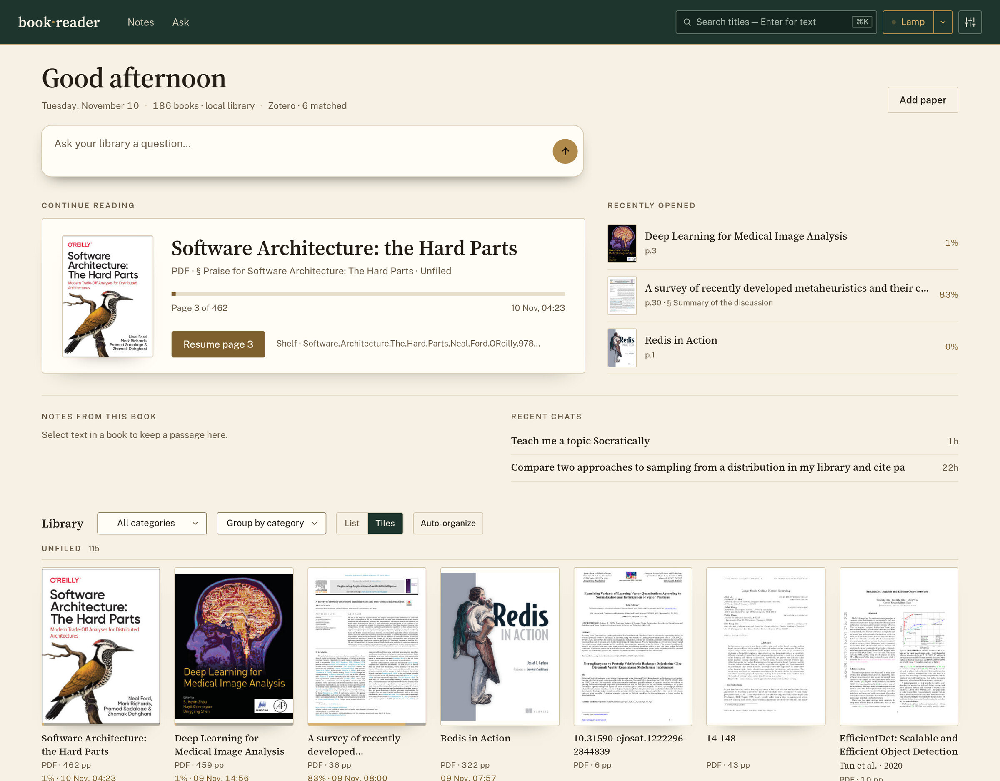
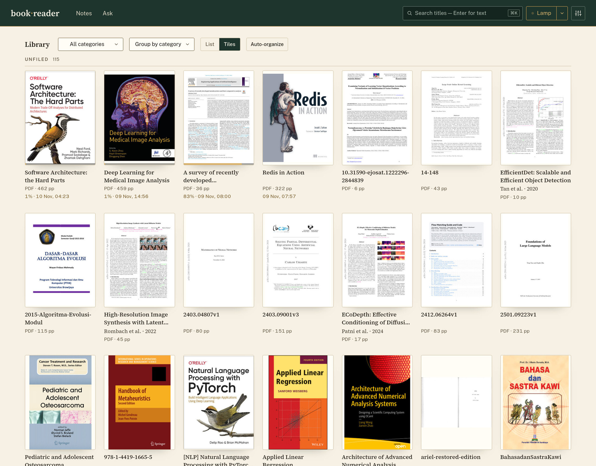
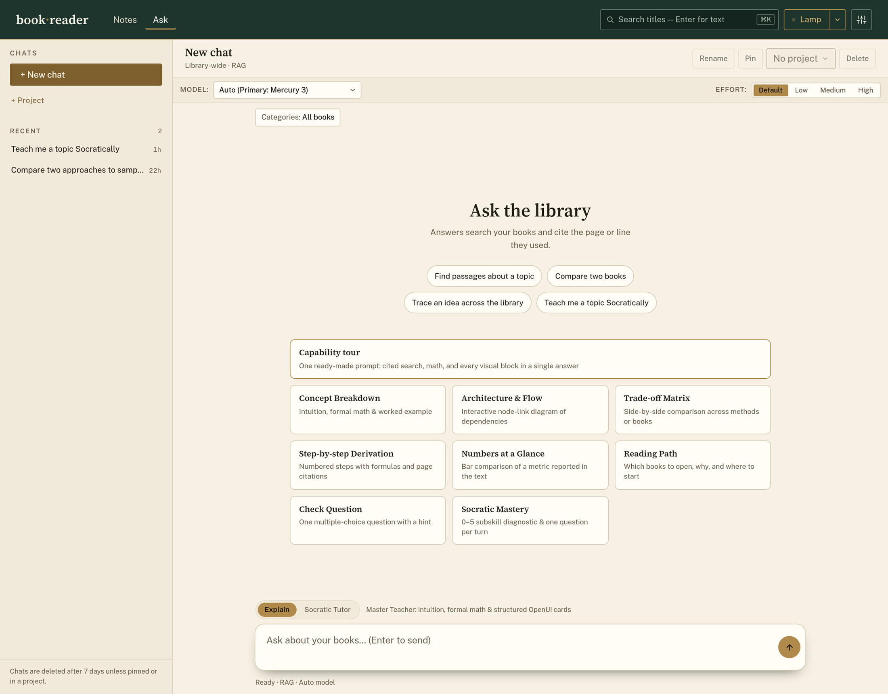
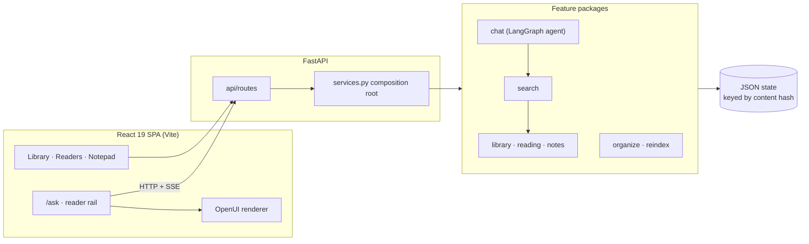

<div align="center">

# 📖 Book Reader

**A local-first reading room for your PDF and Markdown library, with an AI tutor that cites its pages.**

Read, annotate and interrogate your own books. Nothing leaves your machine except the model calls you configure.

[](https://github.com/rafifmalikdzaki/book-reader/actions/workflows/ci.yml)
[](https://www.python.org/)
[](https://react.dev/)
[](https://fastapi.tiangolo.com/)
[](https://vitejs.dev/)
[](#-privacy-and-trust-model)

[Quick start](#-quick-start) ·
[Features](#-features) ·
[Ask](#-ask-grounded-answers-with-a-visible-process) ·
[Retrieval](#-retrieval) ·
[Performance](#-performance) ·
[Configuration](#%EF%B8%8F-configuration) ·
[Development](#%EF%B8%8F-development) ·
[Architecture](#%EF%B8%8F-architecture) ·
[Docs](#-docs)

</div>

---

Book Reader points at a folder of textbooks, papers and notes and gives you one place to read them, mark them up, resume where you stopped, and ask questions that are answered **from the books themselves**. The agent searches and reads your library through tools and cites the exact page or line it used (`paper.pdf#p14`, `notes.md#L40`), so every claim can be checked in one click.

It is built for one person on one machine: no accounts, no database to import into, no cloud.

<div align="center">



<sub><b>Home</b> — a desk, not a file list: what you are reading, what you noted, what you asked, and the shelves below</sub>



<sub><b>Library</b> — covers, progress and categories from the folder you already keep</sub>



<sub><b>Ask</b> — library-wide or book-scoped questions, answered from your books with page citations</sub>

</div>

## ✨ Features

| | |
| :--- | :--- |
| 📚 **Library** | Scans a folder in place (nothing is imported), cover thumbnails, recents, resume cards, and optional AI-assisted virtual categories. Files are never moved or modified. `README.md` files, hidden folders and source checkouts (a folder holding `pyproject.toml`, `package.json`, `Cargo.toml` or `go.mod` and no PDF of its own) are skipped, so a repository kept inside the library does not show up as books. |
| 🏠 **Home** | A desk, not a file list: greeting, an Ask box, continue reading, recently opened, notes from the current book and recent chats, with the library below. Group it by category, tag or Zotero collection. |
| 📑 **Papers** | Paste a DOI or an arXiv id; the open-access PDF is fetched into `Papers/` with its title, authors and keywords written into the file. |
| 🗂️ **Zotero** | Reads a local Zotero library read-only and shows authors, year, tags and collections on the books it recognises. Nothing is written to Zotero. |
| 📄 **Readers** | Native React 19 PDF viewer (`react-pdf` v11) with windowed rendering, single or two-page (facing) view, outline, thumbnails and in-document search. CommonMark reader with KaTeX math and syntax highlighting. |
| 📝 **Notepad** | Select a passage to anchor a note to book + page + character span + section (PDF) or line range (Markdown). Group notes, export as Markdown or JSON context. |
| 💬 **Ask** | Persistent chat sessions grouped by activity and project, scoped to categories or a single book, with live process tracking and cancel. |
| 🧭 **Adaptive prompts** | The backend composes the system prompt per question from small steering modules, and binds only the tools that question needs — a locator question costs ~0.9k prompt tokens instead of ~3.5k. |
| 🎓 **Tutor mode** | A Socratic tutor that maps a topic into 4–8 subskills, runs a one-question-at-a-time diagnostic, and tracks 0–5 mastery. |
| 🧩 **Generative UI** | Answers render typed components (concept cards, graphs, comparison tables, charts, walkthroughs, quizzes) instead of walls of text. |
| 🔎 **Retrieval** | Elasticsearch BM25 → PageIndex section trees → local scan, degrading gracefully when a backend is missing. |
| 🔁 **Move-proof state** | SHA-256 content hashes mean progress, notes and chats follow a file when you rename or move it. |
| 🕯️ **Reading atmospheres** | Three themes you can switch without a reload: *Daylit Paper*, *Amber Study* and *Midnight Baize*. |

## 🚀 Quick start

**Requirements:** Python 3.12+, [uv](https://docs.astral.sh/uv/) and Node.js 22+.

```bash
git clone https://github.com/rafifmalikdzaki/book-reader.git
cd book-reader
uv run book-reader --library ~/Documents/Books
```

Open <http://127.0.0.1:8000>.

> [!NOTE]
> On first run `book-reader` builds the React bundle automatically (`scripts/build_frontend.sh`), so the first start takes a little longer. The default library is `~/Documents/Books`.

<details>
<summary><strong>Docker Compose</strong> (with Elasticsearch)</summary>

```bash
docker compose up --build
```

Mounts `~/Documents/Books` read-only at `/library` (override with `BOOKS_DIR`). State persists in the `reader-state` volume and BM25 data in `es-data`. The port is published on `127.0.0.1` only and the app answers loopback `Host` headers only.

</details>

### Turn on Ask

Reading works without any key. To ask questions, add at least one provider key to a local, gitignored `.env` (copy `.env.example`):

```env
MISTRAL_API_KEY=...       # or MISTRAL_API
GEMINI_API_KEY=...        # or GEMINI_API / GOOGLE_API_KEY
INCEPTION_API_KEY=...
OPENROUTER_API_KEY=...
OLLAMA_API_KEY=...        # or run a local Ollama for fully offline use
```

Providers are tried in priority order and fall back automatically; see [Configuration](#%EF%B8%8F-configuration).

## 💬 Ask: grounded answers with a visible process

1. **Search and read, don't guess.** The agent works in a bounded tool loop:

   | Tool | Purpose |
   | :--- | :--- |
   | `search_library` | Ranked passages across the library or one book |
   | `list_books` | Browse titles and categories |
   | `get_book_outline` | PageIndex layout tree or Markdown heading hierarchy |
   | `read_section` | A whole section span, up to 10 pages / 10,000 characters, so proofs are not cut off |
   | `read_document` | Specific pages or lines |
   | `read_notes` / `add_note` | Read your marginalia into the loop; save a finding back as a note |

   The instruction set adapts to the question. A deterministic selector picks at most two
   steering modules — locate, explain, compare, derive, map, quantify, survey, notes, deep
   read, tutor — and binds only their tools. Locator and note questions skip the visual
   component guide entirely; explanation-shaped questions keep it. Nothing is chosen by a
   second model call, so this costs no latency.

2. **Watch it work.** While the answer is generated, a live process card streams the tool steps, the passages found (with links straight to the page), and the model's reasoning. Collapse it when you only want the answer; scrolling up never yanks you back down. Finished answers keep the trace in a collapsible *thought* section.
3. **Choose model and effort.** Switch the active model and reasoning effort (`low`, `medium`, `high`, `default`) from the bar above the transcript, in both `/ask` and the reader rail.
4. **Stop any time.** The Stop button cancels the in-flight generation server-side.
5. **Side by side.** Open the Ask rail next to a book; it knows the current book and page. Rails drag-resize up to half the viewport.

Sessions are kept for **7 days of inactivity**; pinned and project-assigned chats are exempt.

### Tutor mode

Switch to *Socratic Tutor* (or say "teach me", "quiz me") and the agent decomposes a chapter into subskills, diagnoses before it lectures, and probes misconceptions one step at a time. Commands: `show progress`, `harder` / `easier`, `quiz me`, `just tell me`, `save state`, `resume from: …`. The skill is adapted from Jane Street's [`agent_skills`](https://github.com/janestreet/agent_skills/blob/master/socratic-tutor/SKILL.md).

## 🎨 Generative UI

Answers are written in [OpenUI](https://github.com/thesysdev/openui) and rendered progressively while they stream. The typed component library in `frontend/src/features/chat-render/openui/library.tsx` is the single source of truth; the model prompt is generated from it (`just gen-prompt`) and committed, so a Python-only install needs no Node.

| Question | Component |
| :--- | :--- |
| Explain a concept or section | `ConceptCard` (intuition, formal, example, takeaways) |
| How do parts relate | `ConceptGraph` (interactive node-link diagram) |
| Compare options | `ComparisonTable` with a verdict |
| Benchmarks and numbers | `Chart` |
| Derivations and algorithms | `StepWalkthrough` with LaTeX |
| What should I read | `BookList` with outline and open links |
| Tutoring | `SkillMap` mastery ring, `QuizCheck` |

The model writes JSON blocks by default; set `BOOK_READER_OPENUI_FORMAT=lang` to opt into OpenUI Lang ([ADR-008](docs/decisions/ADR-008-openui-native.md)). A per-model registry (`src/book_reader/chat/models.json`) records which models accept `reasoning_effort` and which format they follow.

## 🔎 Retrieval

`--search` (or `BOOK_READER_SEARCH`) picks the backend:

| Mode | Strategy |
| :--- | :--- |
| `auto` *(default)* | Elasticsearch BM25 if reachable, then PageIndex section trees, then local scan |
| `pageindex` | Vectorless hierarchy search over offline layout trees; no external services |
| `elastic` | Elasticsearch BM25 chunk search |
| `local` | In-process scored text scan |

On the maintainer's library benchmark, PageIndex hybrid reached hit@1 1.00 (MRR 0.95, ~9 ms) against 0.90 for Elasticsearch and 0.20 for the local scan (`just benchmark-rag`, [details](docs/NEXT-STEPS.md)). Your numbers will differ with your library.

Retrieval is cached for the life of the process: decoded section trees, whitespace-normalized page text, and a 64-entry query→hits LRU keyed by each file's `(rel, mtime, size)` and the cached tree set. A repeated question costs ~0.2 ms; a new one reuses every page already extracted. An edited file misses instead of answering from stale text.

```bash
uv run book-reader --index      # build the Elasticsearch index, then exit (--force-index rebuilds)
uv run book-reader --reindex    # after moving/renaming files outside the app: match by content, migrate state
```

## 📊 Performance

Measured on the maintainer's machine against the real library — 186 books, 10 cached
PageIndex section trees, loopback, no model calls in the retrieval timings. The full ledger,
including rejected ideas, is in [`docs/performance.md`](docs/performance.md).

**Retrieval** (`library_wide(query, 12)`, in-process):

| Operation | Before | After |
| :--- | ---: | ---: |
| Repeat of the same question, warm process | 331 ms | **0.2 ms** |
| Six identical tool calls in one answer | 1.31 s | **0.7 ms** |
| A new question, warm process (pages already read) | 303 ms | **163 ms** |
| First question after a restart (516 pages extracted) | 1.91 s | 1.71 s |

The first post-restart scan still pays for extracting the pages it needs; a later question
reuses them. The wins come from memoizing decoded section trees (62% of the warm profile),
caching normalized page text, and returning a remembered hit list — not from reading less of
the book. These are retrieval numbers: on a real answer the model's own latency dominates.

**Prompt cost** (system prompt + tool schemas and descriptions, ≈ characters / 4):

| Ask request | Before | After |
| :--- | ---: | ---: |
| Plain question, no book open | 3,461 tok | **1,380 tok** |
| Locator question ("what page defines…") | 3,461 tok | **946 tok** |
| Save a passage to notes | 3,461 tok | **806 tok** |
| Library survey ("which books should I read…") | 3,461 tok | 3,084 tok |
| Explanation ("explain consistent hashing") | ~3,200 tok | 2,653 tok |
| Book page + 8k-character excerpt, locator | 5,141 tok | 3,021 tok |
| Socratic tutor | 5,530 tok | 5,001 tok |

**Web** (headless Chromium, 1440×900, loopback, warm server): LCP 948 ms on `/` and 424 ms
on `/ask`, CLS 0.03 / 0, initial JS 164.7 KB gzip with route chunks loaded on demand.
PDF.js and KaTeX are vendored and precompressed; no CDN is contacted.

## ⚙️ Configuration

Flags win over environment variables, which win over defaults. `.env` is loaded at startup.

| Flag | Env | Default |
| :--- | :--- | :--- |
| `--library` | `BOOK_READER_LIBRARY` | `~/Documents/Books` |
| `--state-dir` | `BOOK_READER_STATE_DIR` | `~/.local/state/book-reader` |
| `--host` / `--port` | `BOOK_READER_HOST` / `BOOK_READER_PORT` | `127.0.0.1` / `8000` |
| `--search` | `BOOK_READER_SEARCH` | `auto` |
| `--es-url` / `--es-index` | `BOOK_READER_ES_URL` / `BOOK_READER_ES_INDEX` | *(off)* / `book-reader` |
| `--zotero-dir` | `BOOK_READER_ZOTERO_DIR` | `~/Zotero` when it holds `zotero.sqlite`; empty turns it off |
| – | `BOOK_READER_UNPAYWALL_EMAIL` | *(off)* contact address that lets DOI import ask Unpaywall for an open-access copy |
| – | `BOOK_READER_ALLOWED_HOSTS` | optional comma list of accepted `Host` headers |
| – | `BOOK_READER_CHAT_PRIORITY` | comma list of `provider:model` tried in order |
| – | `BOOK_READER_OPENUI_FORMAT` | `json` (or `lang`) |

<details>
<summary>Default provider priority and per-provider model overrides</summary>

```env
BOOK_READER_CHAT_PRIORITY=inception:mercury-3,gemini:gemini-3.8-flash,mistral:mistral-small-latest,mistral:ministral-8b-latest,mistral:zai-glm-5-3-flash,openrouter:openrouter/free,openrouter:nvidia/nemotron-3-ultra-550b-a55b:free,ollama:gpt-oss:20b
```

Override a single provider's model with `BOOK_READER_{INCEPTION,GEMINI,MISTRAL,OPENROUTER,OLLAMA}_MODEL`. Every model in the priority list needs an entry in `models.json`.

</details>

## 🔒 Privacy and trust model

- **Local by design.** Single user, no auth, no telemetry or analytics. The server binds `127.0.0.1` by default and supports a `Host` allow-list against DNS rebinding.
- **Offline assets.** The PDF.js worker, CMaps, fonts and KaTeX are vendored in `static/vendor/`; there is no CDN dependency.
- **You choose the model.** Ask sends your question and the retrieved passages to the provider you configure. Use a local Ollama to keep everything on the machine. The optional categorizer sends only a document's title, section headings and a short first-page excerpt to Mistral, and only after you confirm in the UI.
- **Paper import is the one outbound fetch.** It runs only when you paste an identifier, talks to arXiv, Crossref and (if you set an email) Unpaywall, then downloads the PDF over HTTPS from a public host. Private and loopback addresses are refused, redirects are re-checked, the connection goes to the address that was checked, and the result must be a PDF under 150 MB. Paywalled papers are reported as such, not worked around.
- **Zotero is read-only.** The database is opened immutable; no API key, no sync, no writes.
- **Crash-safe storage.** State is plain JSON under a cross-process lock, written atomically with backups, and recovered on startup.
- **Untrusted content stays inert.** Raw HTML in Markdown is not executed, and `/raw` serves only PDF, Markdown and raster images inline (everything else downloads as `application/octet-stream`).

See [ADR-004](docs/decisions/ADR-004-local-trust-boundary.md) for the threat model.

### Sharing over ngrok

The app has no login, so a tunnel makes your library, notes, chats and model keys available to anyone who has the URL. Share it only with people you trust and stop the tunnel when you are done.

```bash
just share              # server on :8000 that accepts *.ngrok-free.app / .dev / .io Host headers
ngrok http 8000         # in another terminal; send the printed https URL
```

Without `just`, set `BOOK_READER_ALLOWED_HOSTS=localhost,127.0.0.1,::1,.ngrok-free.app` yourself. Everyone shares one set of chats, notes and reading progress.

## 🛠️ Development

```bash
just ci            # full gate: ruff + mypy + pytest + ESLint + tsc + vitest + build
just check         # linters and type checkers only
just test          # pytest + vitest
just fmt           # ruff format + autofix
just run           # server on :8000
just dev-ui        # Vite HMR on :5173, proxies the API to :8000
just eval-offline  # Ask + OpenUI eval suite (no network)
just gen-prompt    # regenerate the OpenUI system prompt from the component library
```

No `just`? Every recipe is a thin wrapper over `uv run …` and `npm run …`.

Tests never touch Elasticsearch or LLM providers; they use small fakes. Contributor rules and invariants live in [`AGENTS.md`](AGENTS.md) and [`CLAUDE.md`](CLAUDE.md).

## 🏗️ Architecture



The backend is feature-first ([ADR-009](docs/decisions/ADR-009-feature-first-backend.md)): domain packages never import FastAPI, they raise domain errors that `api/errors.py` maps to HTTP.

```
src/book_reader/
├── api/        routes, errors, security headers, static serving
├── chat/       LangGraph agent, tools, providers, sessions, model registry
├── library/    path-safe scan and book models
├── reading/    PDF/Markdown readers, pages, progress, section trees
├── notes/      anchored notepad
├── search/     Elasticsearch, PageIndex, local scan
├── organize/   AI-assisted categories
├── reindex/    content-hash reconciliation
├── state/      process lock, preferences, state remapping
├── services.py composition root
└── app.py      FastAPI factory
frontend/src/   app shell · features/<page> · ui primitives · tokens
```

<details>
<summary><strong>HTTP API</strong></summary>

| Route | Methods | Purpose |
| :--- | :--- | :--- |
| `/healthz` | GET | Liveness |
| `/api/library` | GET | Library index, categories, recents |
| `/api/book`, `/api/book/markdown`, `/api/pages` | GET | Viewer metadata, sanitized Markdown + outline, page text |
| `/api/progress` | GET, POST | Reading position |
| `/api/zotero` | GET | Zotero items matched to library books, plus collections |
| `/api/papers/import` | POST | Fetch a paper by DOI or arXiv id into `Papers/` |
| `/api/papers/keywords` | GET | Keywords, authors and DOI embedded in library PDFs |
| `/api/search` | GET | In-book or library-wide search |
| `/api/library/reindex` | POST | Content-hash reconciliation |
| `/api/index/status`, `/api/index/rebuild` | GET, POST | Elasticsearch index |
| `/api/organize`, `/api/organize/status` | POST, GET | Categorization job |
| `/api/chat/status`, `/api/chat/options` | GET, POST | Providers, active model and effort |
| `/api/chat` | POST | Stateless ask (reader rail) |
| `/api/chat/sessions[/{id}]` | GET, POST, PATCH, DELETE | Persistent sessions |
| `/api/chat/sessions/{id}/messages` | POST | Send a question (`teacher` or `tutor`) |
| `/api/chat/sessions/{id}/events` | GET | SSE: `step`, `found`, `thought`, `delta`, `done`, `error` |
| `/api/chat/sessions/{id}/cancel` | POST | Abort generation |
| `/api/chat/projects[/{id}]` | GET, POST, DELETE | Chat projects |
| `/api/notepad` and `/notes`, `/groups`, `/export` | GET, POST, PATCH, DELETE | Anchored notes and groups |
| `/raw/{rel}`, `/thumb.jpg` | GET | Library files and covers |

</details>

## 📚 Docs

- [`docs/decisions/`](docs/decisions/README.md): architecture decision records (SPA, PDF viewer, reindex, trust boundary, OpenUI, backend layout)
- [`docs/book-reader-architecture.html`](docs/book-reader-architecture.html): interactive architecture diagram
- [`docs/NEXT-STEPS.md`](docs/NEXT-STEPS.md) and [`docs/performance.md`](docs/performance.md): roadmap and measurements
- [`PRODUCT.md`](PRODUCT.md): who this is for and what it deliberately is not
- [`CHANGELOG.md`](CHANGELOG.md)

<div align="center">
  <sub>Built for focused, long-form technical reading.</sub>
</div>
